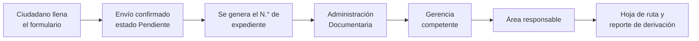
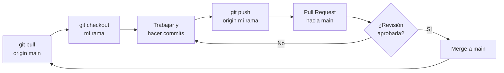

<div align="center">

# 🗂️ Del archivador al algoritmo

### Prototipo de Mesa de Partes Digital

Registrar · Validar · Buscar · Ordenar · Almacenar expedientes


**Fundamentos de Programación (CIIN1205P) · Universidad Privada del Norte**

</div>

---

## 📑 Contenido

1. [Integrantes](#-integrantes)
2. [Contexto](#-contexto)
3. [Caso observado](#-caso-observado)
4. [Análisis: entradas, procesos y salidas](#-análisis-entradas-procesos-y-salidas)
5. [Funcionalidades](#-funcionalidades)
6. [Estructura del proyecto](#-estructura-del-proyecto)
7. [Cómo ejecutarlo](#-cómo-ejecutarlo)
8. [Trabajo con ramas en Git](#-trabajo-con-ramas-en-git)
9. [Protección de datos personales](#-protección-de-datos-personales)
10. [Referencias](#-referencias)

---

## 👥 Integrantes

| N.° | Nombre completo | Rama |
|:---:|---|---|
| 1 | Cesar Farid Cruz Cruces | `T1-Cruz-Cruces` |
| 2 | Josue David Mazuelos Valqui | `T1-Mazuelos-Valqui` |
| 3 | Kevin Hernan Astete Llancare | `T1-Astete-Llancare` |
| 4 | Andy Cristhofer Acosta Guillen | `T1-Acosta-Guillen` |
| 5 | Italo Angelo Olivares Martinez | `T1-Olivares-Martinez` |

> **Docente:** Percy Angel Pardo Zapata

---

## 🏛️ Contexto

La **Ley N.° 31170** obliga a las instituciones del Estado a implementar mesas de partes digitales con notificaciones electrónicas. Muchas entidades todavía registran sus trámites a mano.

| Alternativa | Obstáculo |
|---|---|
| Contratar un desarrollador | El 75 % de las empresas declara dificultades para cubrir vacantes tecnológicas (INEI, 2025) |
| Capacitar al personal | Un bootcamp intensivo cuesta cerca de S/ 19,000 por persona |
| Tercerizar el sistema | La oficina pierde el control del proyecto |

**Nuestra propuesta:** un prototipo propio que reemplace el registro manual por un sistema simple y funcional.

---

## 🔍 Caso observado

Observamos el recorrido real de una solicitud en la **Mesa de Partes Virtual de la Municipalidad Distrital de San Juan de Miraflores**.



La bitácora fotográfica y la entrevista estarán en la carpeta `docs/`.

---

## 🧩 Análisis: entradas, procesos y salidas

| 📥 Entradas | ⚙️ Procesos | 📤 Salidas |
|---|---|---|
| Datos del ciudadano | Registrar | Código de expediente |
| Asunto | Validar | Estado del trámite |
| Documento adjunto | Asignar código | Listado ordenado |
| | Buscar y ordenar | Archivo con los registros |
| | Guardar | |

---

## ✅ Funcionalidades

- [ ] Menú principal con estructuras de control
- [ ] Registrar expedientes (código, nombre, DNI, asunto, fecha, estado)
- [ ] Validar datos (campos vacíos, DNI de 8 dígitos numéricos, formato de código, código no repetido)
- [ ] Buscar un expediente por código
- [ ] Ordenar expedientes por código o fecha
- [ ] Guardar y cargar los datos desde un archivo
- [ ] Listar todos los expedientes

---

## 📁 Estructura del proyecto

> Propuesta inicial; se ajustará según cómo dividamos el trabajo.

```
Fundamentos-de-Programacion-Grupo07-Desafio-EF/
├── main.py               # menú principal
├── validaciones.py       # validación de datos
├── almacenamiento.py     # lectura y escritura de archivos
├── busqueda_orden.py     # búsqueda y ordenamiento
├── datos/                # archivos de datos (solo datos ficticios)
├── docs/                 # bitácora, diagrama de flujo y pseudocódigo
└── README.md
```

---

## ▶️ Cómo ejecutarlo

**Requisitos:** Python 3.10 o superior.

```bash
git clone https://github.com/faridcr/Fundamentos-de-Programacion-Grupo07-Desafio-EF.git
cd Fundamentos-de-Programacion-Grupo07-Desafio-EF
python main.py
```

---

## 🌿 Trabajo con ramas en Git

Trabajamos con **una rama por integrante** y nadie hace commit directo a `main`. Así practicamos el flujo de equipo: crear ramas, hacer *pull requests*, fusionar (*merge*) y resolver conflictos.

### Ramas del repositorio

| Rama | Uso |
|---|---|
| `main` | Versión estable del proyecto. Solo recibe cambios por *pull request* |
| `T1-Cruz-Cruces` | Rama de trabajo de Cesar Cruz |
| `T1-Mazuelos-Valqui` | Rama de trabajo de Josue Mazuelos |
| `T1-Astete-Llancare` | Rama de trabajo de Kevin Astete |
| `T1-Acosta-Guillen` | Rama de trabajo de Andy Acosta |
| `T1-Olivares-Martinez` | Rama de trabajo de Italo Olivares |

### Flujo de trabajo



### Paso a paso

```bash
# 1. Traer lo último de main
git checkout main
git pull origin main

# 2. Ir a mi rama y ponerla al día
git checkout T1-Apellido-Apellido
git merge main

# 3. Trabajar, guardar y subir
git add archivo.py
git commit -m "Agrega validación de DNI"
git push origin T1-Apellido-Apellido

# 4. Abrir un Pull Request en GitHub (mi rama → main)
```

### ⚔️ Cómo resolver un conflicto

Un conflicto aparece cuando dos personas editan **la misma línea** del mismo archivo. Git marca el archivo así:

```
<<<<<<< HEAD
Texto de mi rama
=======
Texto que viene de main
>>>>>>> main
```

1. Abrir el archivo y decidir qué versión se queda (una, la otra, o una mezcla).
2. Borrar las tres líneas de marcas: `<<<<<<<`, `=======` y `>>>>>>>`.
3. Guardar y cerrar el merge:

```bash
git add archivo.py
git commit -m "Resuelve conflicto en archivo.py"
git push origin T1-Apellido-Apellido
```

> 💡 Si el conflicto se complica, `git merge --abort` cancela el merge y vuelve al estado anterior sin perder nada.

### Reglas del equipo

| ✔️ Hacer | ❌ Evitar |
|---|---|
| Traer `main` antes de empezar a trabajar | Hacer commit directo a `main` |
| Hacer commits pequeños con mensajes claros | Mensajes como `cambios` o `arreglo` |
| Revisar el Pull Request de otro integrante | Aprobar sin leer el código |
| Avisar al grupo antes de editar un archivo ajeno | Fusionar varios Pull Requests a la vez |

### Comandos útiles

| Comando | Para qué sirve |
|---|---|
| `git status` | Ver qué archivos cambiaron |
| `git branch` | Ver en qué rama estoy |
| `git log --oneline --graph` | Ver el historial con las ramas |
| `git diff` | Ver los cambios sin guardar |
| `git stash` | Guardar cambios a medias para cambiar de rama |
| `git merge --abort` | Cancelar un merge con conflicto |

---

## 🔒 Protección de datos personales

El prototipo se prueba únicamente con **datos ficticios**. No se publican DNI, nombres ni cuentas reales tomados de la observación de campo.

---

## 📚 Referencias

- Congreso de la República del Perú (2021). *Ley N.° 31170, Ley que dispone la implementación de mesas de partes digitales y notificaciones electrónicas*.
- Presidencia del Consejo de Ministros (2018). *Decreto Legislativo N.° 1412, Ley de Gobierno Digital*.
- Joyanes Aguilar, L. (2020). *Fundamentos de programación*. McGraw-Hill.

---

<div align="center">

Avance correspondiente a la **Evaluación Parcial (EP)** · El proyecto continúa hacia la Evaluación Final

</div>
